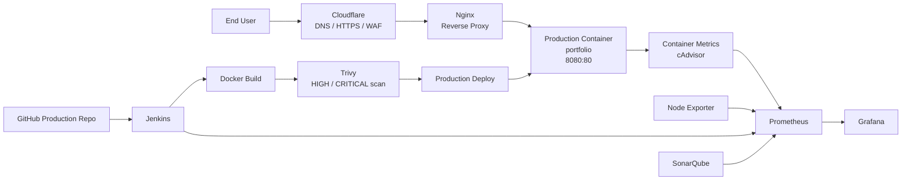

# Portfolio Platform — Production

> Live production deployment for a self-managed DevOps / DevSecOps portfolio project.
>
> This repository represents the release target: a containerized portfolio application delivered through Cloudflare and Nginx on a Rocky Linux VPS.

## Overview

This project started as a portfolio website and evolved into a practical DevOps platform covering infrastructure, containerization, reverse proxying, CI/CD, security scanning, and observability.

The production repository exists to keep the **live application** separate from the staging environment so that experimentation and validation do not directly modify the public deployment.

## Production architecture



### Public request path

```text
Internet
  ↓
Cloudflare
  ↓ HTTPS
Nginx reverse proxy
  ↓ HTTP localhost:8080
portfolio container
  ↓
Nginx static content
```

### Deployment path

```text
Developer
  ↓
Git commit / push
  ↓
GitHub
  ↓
Jenkins
  ↓
Clone
  ↓
Docker build
  ↓
Trivy scan
  ↓
Replace production container
  ↓
Live application
```

## Production environment

| Component | Production role |
|---|---|
| Linux | Rocky Linux on a self-managed VPS |
| Source control | Git / GitHub |
| CI/CD | Jenkins |
| Container runtime | Docker |
| Image | `portfolio-app` |
| Container name | `portfolio` |
| Host port | `8080` |
| Container port | `80` |
| Reverse proxy | Nginx on the VPS host |
| DNS / edge / HTTPS | Cloudflare |
| Origin TLS | Cloudflare Origin Certificate |
| Image security | Trivy |
| Code analysis | SonarQube |
| Monitoring | Node Exporter, cAdvisor, Prometheus, Grafana |
| Host protection | firewalld, SSH hardening, Fail2Ban, SELinux controls |

## Live application

The documented production hostname is:

```text
https://awashmasketech.co.uk
```

Jenkins is exposed separately through the documented subdomain:

```text
https://jenkins.awashmasketech.co.uk
```

Do not place private infrastructure endpoints, passwords, API tokens, private keys, or internal credentials in this README.

## Repository structure

A clean production repository should contain application source and deployment configuration, for example:

```text
.
├── index.html
├── assets/
├── Dockerfile
├── .dockerignore
├── Jenkinsfile              # when pipeline-as-code is used
├── sonar-project.properties # when source analysis is configured here
└── README.md
```

The repository should remain the **source of truth** for the production application rather than relying on edited files left on the VPS.

## Docker image

The production application is served by Nginx inside the container.

Example image definition:

```dockerfile
FROM nginx:alpine
COPY . /usr/share/nginx/html
```

Build locally:

```bash
docker build -t portfolio-app:latest .
```

Run the production container manually for verification:

```bash
docker rm -f portfolio 2>/dev/null || true

docker run -d \
  --name portfolio \
  -p 8080:80 \
  portfolio-app:latest
```

Verify:

```bash
docker ps
curl -I http://127.0.0.1:8080
```

## Nginx reverse proxy

The host-level Nginx instance owns public ports `80` and `443`. The Docker application remains bound to `8080` so Nginx can provide the public entry point.

Conceptually:

```nginx
server {
    listen 80;
    server_name awashmasketech.co.uk www.awashmasketech.co.uk;
    return 301 https://$host$request_uri;
}

server {
    listen 443 ssl;
    server_name awashmasketech.co.uk www.awashmasketech.co.uk;

    ssl_certificate /etc/nginx/ssl/origin.crt;
    ssl_certificate_key /etc/nginx/ssl/origin.key;

    location / {
        proxy_pass http://127.0.0.1:8080;
        proxy_set_header Host $host;
        proxy_set_header X-Real-IP $remote_addr;
    }
}
```

This keeps the application container isolated from direct public access while Nginx handles routing and TLS at the host layer.

## Cloudflare and TLS

Cloudflare provides DNS, edge protection, and HTTPS. The origin server uses a Cloudflare Origin Certificate and Nginx for the Cloudflare-to-VPS TLS leg.

Production delivery is therefore:

```text
Client
  ↓ HTTPS
Cloudflare
  ↓ HTTPS
Nginx / Origin Certificate
  ↓ HTTP localhost:8080
Docker portfolio container
```

The documented working configuration uses Cloudflare **Full (Strict)**.

### Why this matters

The project encountered Cloudflare Error 521 during setup. Troubleshooting covered:

- DNS records and resolution
- Nginx `server_name` mismatches
- default Nginx configuration conflicts
- port availability
- firewalld
- SELinux
- Cloudflare SSL mode
- direct VPS connectivity

The final documented configuration used the correct domain routing, a reachable Docker upstream, an origin certificate, and Cloudflare Full (Strict).

## Jenkins CI/CD

Jenkins is used to automate the production deployment workflow.

The documented pipeline evolved to the following model:

```text
GitHub
  ↓
Clean workspace
  ↓
Clone repository
  ↓
Build Docker image
  ↓
Trivy image scan
  ↓
Stop/remove old container
  ↓
Start new container on 8080
```

Simplified example:

```groovy
pipeline {
    agent any

    stages {
        stage('Clean Workspace') {
            steps {
                deleteDir()
            }
        }

        stage('Clone Repo') {
            steps {
                git branch: 'main', url: '<production-repository-url>'
            }
        }

        stage('Build Docker Image') {
            steps {
                sh 'docker build -t portfolio-app:latest .'
            }
        }

        stage('Security Scan (Trivy)') {
            steps {
                sh '''
                docker run --rm \\
                  -v /var/run/docker.sock:/var/run/docker.sock \\
                  aquasec/trivy:0.69.3 \\
                  image --severity HIGH,CRITICAL --exit-code 0 portfolio-app:latest
                '''
            }
        }

        stage('Deploy') {
            steps {
                sh '''
                docker rm -f portfolio || true
                docker run -d \\
                  --name portfolio \\
                  -p 8080:80 \\
                  portfolio-app:latest
                '''
            }
        }
    }
}
```

## Security controls

### Trivy

Trivy is placed in the deployment pipeline to scan the Docker image before deployment.

Current learning-stage behaviour:

```bash
--severity HIGH,CRITICAL --exit-code 0
```

This means high and critical findings are reported but **do not currently fail the deployment**.

That distinction is important: the pipeline contains a security scan, but it is not yet a hard production release gate.

A stricter production policy would use:

```bash
--severity HIGH,CRITICAL --exit-code 1
```

with an agreed vulnerability-management process for exceptions and remediation.

### SonarQube

SonarQube was successfully used for source-code analysis in the project and the staging codebase was analysed successfully. The documented implementation treats SonarQube as a separate code-quality/security analysis capability, with CI integration identified as a further improvement.

Typical analysis areas include:

- bugs
- vulnerabilities
- code smells
- security hotspots

### OWASP ZAP

OWASP ZAP is identified in the project documentation as a later learning phase for dynamic application security testing (DAST). It should therefore be presented as **planned / future work**, not as a completed control.

### Host and edge security

The project also implemented or practised:

- Cloudflare DNS / edge protection
- HTTPS using an origin certificate
- firewalld rules
- SSH security practices
- Fail2Ban
- SELinux-aware Nginx configuration

## Monitoring and observability

The monitoring stack is layered so that host, container, CI, and application-platform metrics can be observed.

```text
Node Exporter ──┐
                ├──> Prometheus ──> Grafana
cAdvisor ───────┤
Jenkins ─────────┤
SonarQube ───────┘
```

The documented final monitoring state included successful visibility for:

- Node Exporter / Linux host metrics
- cAdvisor / Docker metrics
- Jenkins metrics
- SonarQube metrics

Example health checks used during setup:

```bash
curl http://localhost:9100/metrics
curl http://localhost:9090/-/healthy
curl http://localhost:8083/metrics
```

> Monitoring endpoints should not be exposed directly to the public internet unless there is a deliberate security control around them.

## Production operations lessons

This project deliberately documents failures because they represent useful operational experience.

### Cloudflare 521

A 521 occurred when Cloudflare could not establish a valid connection to the origin. Debugging required separating DNS problems from origin-server problems and checking Nginx, firewall, SELinux, and TLS configuration independently.

### Nginx / Docker port conflicts

Initially both the application container and host Nginx attempted to use port `80`. The application was moved to `8080` so that host-level Nginx could own the public ports.

### 502 Bad Gateway

A 502 occurred when Nginx could not reach the application upstream. The investigation covered container state, image construction, port mappings, and the Nginx `proxy_pass` target.

### Jenkins and Docker socket

Jenkins was run in Docker and granted access to the host Docker engine using the Docker socket:

```text
/var/run/docker.sock
```

This was useful for the learning environment, but it is a high-privilege design. In a more hardened environment, the build/deploy architecture should be redesigned so that the CI service does not receive unrestricted access to the host Docker daemon.

## Release discipline

The production repository should represent a known release candidate rather than an experiment.

A safer promotion model is:

```text
Change
  ↓
Staging
  ↓
Build verification
  ↓
Security checks
  ↓
Functional validation
  ↓
Production release
```

## Recommended hardening roadmap

The following items are logical next steps from the current implementation:

1. Replace `latest` with immutable version or commit-based image tags.
2. Make Trivy policy-based and fail production releases on defined severities.
3. Add SonarQube quality gates to Jenkins.
4. Add OWASP ZAP DAST after the application is available in staging.
5. Use a registry as an explicit build artifact repository and promote the same image between environments.
6. Add container health checks and verify application readiness before routing traffic.
7. Avoid destructive `docker rm -f` deployment behaviour for higher availability.
8. Store all credentials in Jenkins Credentials / a secret manager.
9. Restrict Docker socket access and separate build from production deployment privileges.
10. Add rollback to a known-good image tag.

## What this repository demonstrates

This production repository demonstrates practical experience with:

- Git and GitHub source control
- Rocky Linux administration
- Docker and container lifecycle management
- Nginx reverse proxying
- Cloudflare DNS and origin TLS
- Jenkins CI/CD
- Trivy container security scanning
- SonarQube code analysis
- Prometheus and Grafana monitoring
- cAdvisor container metrics
- firewalld, SSH, Fail2Ban, and SELinux troubleshooting
- incident-style debugging across multiple infrastructure layers

## Project positioning

This is a **production-oriented learning project** built to practise real operational patterns. It should not be described as a fully enterprise-grade platform: the documentation itself identifies areas such as stronger security gates, DAST, immutable releases, safer deployment strategies, and tighter CI/CD integration as future improvements.

## Author

**Awash Awash**

Hands-on DevOps / DevSecOps portfolio project.
